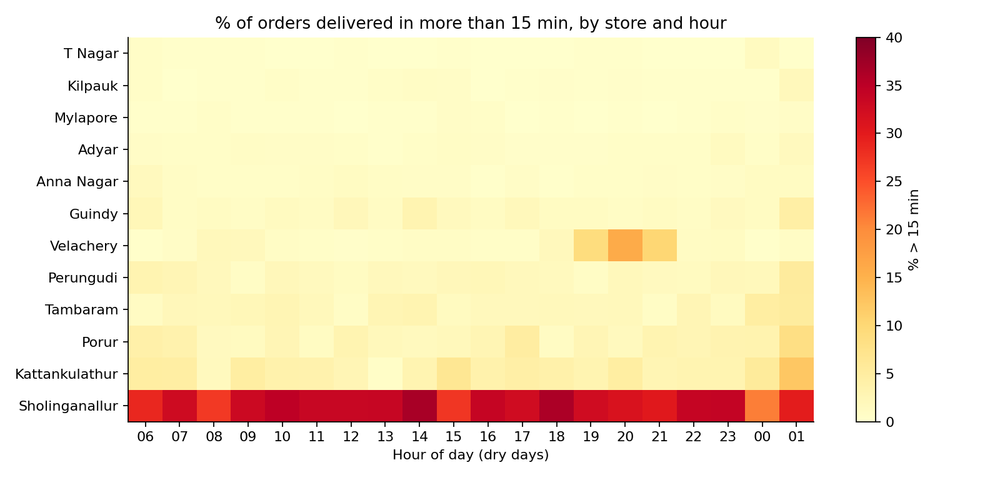

# Dark-Store Ops Analytics

Root-cause analysis of delivery-time breaches and stockouts across a 12-store quick-commerce network in Chennai. It uses SQL, Excel and Python on 314K orders and 1.65M order lines.

**The findings are in [MEMO.md](MEMO.md):** three fixes worth about Rs 9 lakh a month, plus per-store profit and break-even. The biggest-volume problem store is actually loss-making because of its roster.



## What's inside

| Path | What |
|---|---|
| `MEMO.md` | One-page ops memo: findings, root causes, fixes, impact, caveats |
| `sql/analysis.sql` | 13 analysis queries (CTEs, window functions, gaps-and-islands, joins to the rider roster, store unit economics) |
| `results/sql_results.md` | Output of every query |
| `results/DarkStore_Ops_Analysis.xlsx` | Scorecard, heatmap, **what-if rider roster model**, fill-rate matrix, **store economics with break-even (Goal Seek-ready)**, impact sizing (live formulas), 5,000-row raw sample |
| `results/charts/` | Heatmap, roster gap, distance tail, retention |
| `src/generate_data.py` | Simulator that generates the dataset |

## Run it

```bash
python3 -m venv .venv && .venv/bin/pip install -r requirements.txt
.venv/bin/python src/generate_data.py   # ~10 s, builds data/darkstore.db
.venv/bin/python src/run_sql.py         # runs every query -> results/sql_results.md
.venv/bin/python src/build_outputs.py   # Excel + charts
```

## About the data

The data is **simulated**. Real dark-store data is not public. I built a simulator calibrated to public quick-commerce figures: a ~Rs 560 AOV, about 900 orders per store per day, and morning and evening demand peaks. It models riders, picking, travel distance, stockouts, rain days and customer reorder behaviour.

I planted three operational problems in it, the way they hide in real data, and then found and sized them with SQL. The data is synthetic, but the analytical method carries over unchanged. Swap in a real `orders` table with the same schema (`sql/schema.sql`) and every query and the workbook still work.

## Method

1. Rank stores on a scorecard: on-time %, fill rate, rating.
2. Decompose delivery time into pick, rider wait and travel.
3. Separate structural problems (bad all day) from capacity problems (bad only at peak).
4. Join demand to the rider roster and find the orders-per-rider-hour where breach takes off.
5. Find distance tails and stockout hotspots by store, category and daypart.
6. Link lateness to 14-day reorder rate to put a rupee value on each fix.
